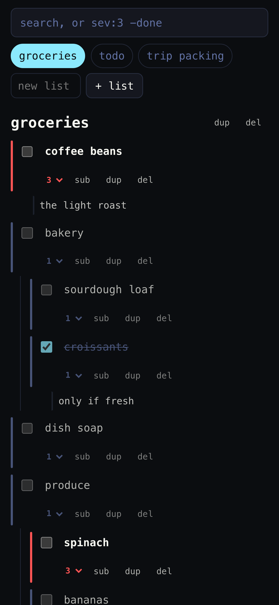
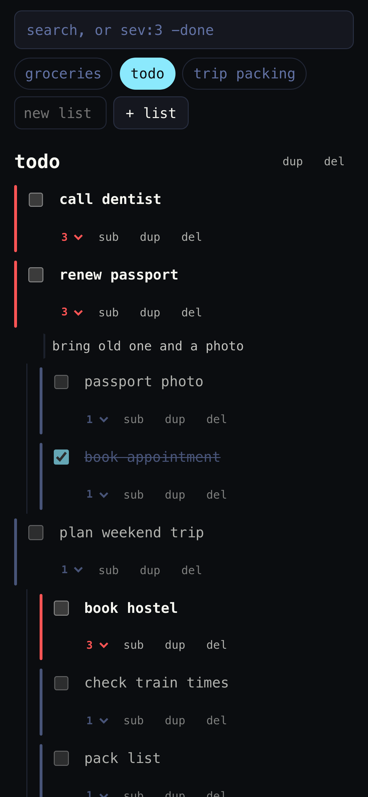

# services

Go services on the tailnet: lists, workouts.

```sh
make build    # bin/<service>
make test
make vet lint
```

| Path | Contents |
|---|---|
| `cmd/<service>/` | binaries |
| `internal/<service>/` | one service each, the UI embedded in the binary |
| `scripts/<service>/`, `docs/<service>/` | screenshot scripts, docs and images |

## lists

Todo and grocery lists as one recursive tree: a list is an item, its entries are items, entries nest. Files are the database.

<p>
  
  
</p>

```sh
make build
bin/lists -addr 127.0.0.1:8082 -data <dir>
make screenshots    # from internal/lists/data/demo
```

One JSON file per list at `<dir>/lists/<id>.json`, the whole tree inside. A save writes the file atomically in the byte layout the files already have, so saving without a change leaves them identical. Files that do not parse, are not a well-formed tree, or are Syncthing conflict copies are skipped. Fixtures for the tests are in `internal/lists/data/lists`.

## workouts

Training blocks on Google Sheets with a phone PWA for logging. Sheet layout, API and offline behaviour: [docs/workouts](docs/workouts/README.md).

```sh
make run SHEETS=<file>    # {"program": "<id>", "active": "<id>", "archive": "<id>"}
make screenshots
```

Building needs cgo, workline parses with its tree-sitter grammar. Live tests against scratch spreadsheets are opt-in, see [docs/workouts/gsheet.md](docs/workouts/gsheet.md).

`capacitor/` wraps the same UI in native Android and iOS apps; a release attaches a signed APK.
Build, sync and install: [docs/workouts/capacitor.md](docs/workouts/capacitor.md).
