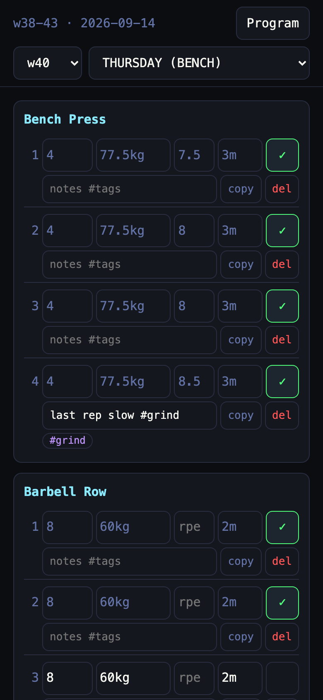
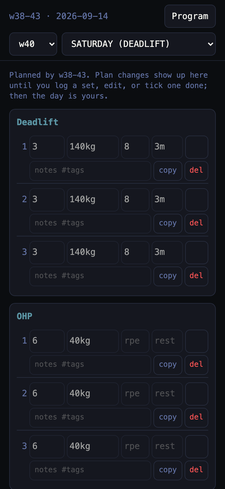
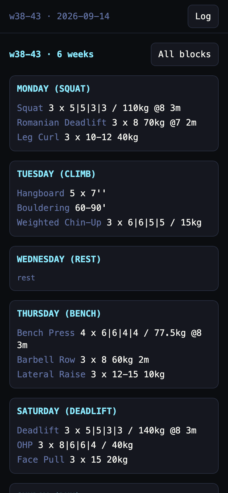

# workouts

Training blocks on Google Sheets with a phone PWA for logging.

<p>
  
  
  
</p>

```sh
echo '{"program": "<id>", "active": "<id>", "archive": "<id>"}' > sheets.json   # keep it out of the repo
make run SHEETS=sheets.json [ADDR=127.0.0.1:8093]
make screenshots
```

`bin/workouts` also takes `-embed <published embed URL>`, `-account`, `-service-account`, `-token`, `-token-file`. Sheets access is a service account (`-service-account key.json` or `GSHEET_SERVICE_PRINCIPAL_JSON`) or the `gsheet auth login` token store; share all three spreadsheets with it as editor. Sheets I/O is [gsheet](gsheet.md), set parsing is [workline](https://github.com/JakobMelchard/workline).

## Spreadsheets

| Sheet | Tabs |
|---|---|
| `program` | One tab per block named `w<from>-<to>` or `w<n>` (calendar weeks); other tabs are ignored |
| `active` | `Block` (`program`, `started`), plus `w<n>` week tabs, one row per set |
| `archive` | `<year> w<n>`, finished weeks |

The program is the template, the week tabs are the log. A day not yet started is shown from the program; starting it (tick or edit a set, add an exercise, `POST .../start`) writes the whole day to its week tab and the program no longer touches it.

Program tab, two columns. A row with an empty Load starts a day; blank rows are ignored:

| A | B |
|---|---|
| MONDAY (OHP) (merged) | |
| Push Press | `4 x 2` |
| OHP | `1 x 8\|6\|4\|2+` |

Load is a workline cell: `'` minutes, `''` seconds, `SETS x` optional for one set (`90-150'`), `a|b|c` steps through the block's weeks and repeats the last. Set ranges (`3-4 x 8`) are not workline; a block with an invalid row cannot start.

Week tab: a day row, its sets (`1x8+`, notes as cell note with `#tags`), a blank row before the next day. The app shows reps (`5`, `8-12`, `5+`, `30s`, `20m`, `2km`), weight (`100kg`, `80%`, `?+`), RPE (`8`, `8+`) and rest (`2m`, `90s`) and writes one canonical cell back. A cell that is not one valid set is kept as typed and flagged `invalid`. Done is kept only in the app, per device, block and week.

## Endpoints

| Method | Path | Purpose |
|---|---|---|
| GET | `/` | App |
| GET | `/block` | `{block: {program, started, weeks}, programs}` |
| POST | `/block` | Archive the block, start form field `program` |
| GET | `/programs/{tab}` | A block tab, days and rows with errors |
| GET | `/weeks/{tab}/rows` | `{days, rows, warning}`; unstarted days come from the program with `planned: true` |
| PATCH | `/weeks/{tab}/rows` | `{"ref": {"index","day","exercise","set"}, "patch": {load, reps, weight, rpe, rest, notes}}` |
| POST | `/weeks/{tab}/rows/duplicate` | Copy one set after it |
| POST | `/weeks/{tab}/rows/delete` | Delete one set |
| POST | `/weeks/{tab}/days/{day}/start` | Start a planned day as prescribed |
| POST | `/weeks/{tab}/days/{day}/exercises` | `{"exercise", "load"}`, one row per set |
| GET, POST | `/login` | Token form, set cookie |
| GET | `/static/manifest.webmanifest`, `/sw.js`, `/web/*` | PWA files |

A changed tab answers 409 and writes nothing. Starting a block copies each active week tab to the archive as `<year> w<n>`, deletes them, then writes `Block`; archive tabs are written first, so a failure loses nothing and a rerun finishes. Sheets reads are limited to 60 a minute per account (week view costs 5, an edit about 8); gsheet retries 429 with backoff. Edits and block starts run one at a time.

## Auth

Every data route, reads included, needs `Authorization: Bearer <t>` or the login cookie, else 401; only `/`, `/login`, `/sw.js`, `/static/*` and `/web/*` are open. Set the token with `WORKOUTS_TOKEN` (not `-token`, flags show in `ps`). A 401 sends the browser to `/login` (the phone app asks for the token instead and keeps it, [capacitor](capacitor.md)); the cookie is HttpOnly, SameSite=Strict, 30 days, and five wrong tokens lock login for a minute. Without a token the server starts only on loopback.

`SENTRY_DSN` reports handler panics (`SENTRY_ENVIRONMENT`, default `production`); unset sends nothing.

## Offline

The service worker caches the shell; the page keeps the last block and week. Set edits queue in localStorage, the header shows "N pending", and they replay in order on `online` or when the app is visible again. A 409 drops that edit, reloads the week and names the edit. Starting a block and editing the program need the network.

## Live test

Writes to three scratch spreadsheets:

```sh
GSHEET_LIVE=1 GSHEET_TEST_PROGRAM=<id> GSHEET_TEST_SHEET=<id> GSHEET_TEST_ARCHIVE=<id> \
  go test -run TestLiveBlock -v ./internal/workouts/block/
```
